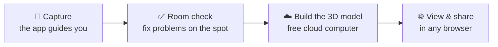

# SplatSpace

### Turn any room or object into a 3D scene you can walk through, using just your phone.

Follow the on-screen guide, and get a photo-real 3D model that opens in any web browser.

---

## What it is

SplatSpace is an Android app that guides you while you photograph a room or an object. It then turns those
photos into a **Gaussian splat**: a realistic 3D scene you can walk around in, from any angle, on a phone or a
computer.

**Great for** home and rental tours, documenting a space, product showcases, and memories of a place.

## What you need

| | |
|---|---|
| 📱 **An Android phone with AR support** | Most phones from the last few years ([check here](https://developers.google.com/ar/devices)). |
| 💻 **A computer** | To copy your capture and look at the result. |
| ☁️ **A free Kaggle account** | [kaggle.com](https://www.kaggle.com) lends you a powerful computer for free to build the 3D model. Verify your phone number in the account settings. |
| ⏱️ **Time** | A room takes about 10 minutes to capture, then about 1–1.5 hours of processing that runs on its own. An object takes about 5 minutes plus 20 minutes. |

---

## How to use it

### 1. Install the app
Download the app from the **Releases** page and open it on your phone. Android will ask once to allow
installing it. Say yes.

### 2. Capture a room

1. Open **SplatSpace**, tap **New capture**, then **Scene capture**. Below the choices you can pick the photo mode:
   **Sharp** (default: turn slowly for the best photos) or **Fast** (quicker, slightly softer photos).
2. **Point at the floor** until it says *Floor found*, then tap **Start scene**.
3. **Turn on the spot.** Hold the phone out at arm's length and turn your whole body slowly, three times:
   phone **level**, tilted **down**, then tilted **up** at the ceiling. Each slice of the circle on screen
   turns green when it's done.
4. **Move to the next spot.** Walk to the **orange dot** on the little room map and tap **Start spot here**.
   A bedroom usually needs 5–8 spots, including one near each corner.
5. **Walls pass.** When the app says the spots are done, tap **Walls pass**. Walk slowly along the walls, about
   1 metre away and facing them. Then go round once more with the phone tilted up toward the ceiling.
6. **Finish.** The app checks your photos for a few seconds (see below). When it's happy, tap **Save**.

> **Capturing an object instead?** Choose **Object capture**, tap the object on screen, and walk around it.
> The app shows markers for where to take photos.

### 3. The room check: fix things before you leave

When you tap **Finish**, the phone checks that all your photos fit together:

- 🔴 **Red** means the 3D model will break, for example *"Spot 3 doesn't connect to the rest of the room"*.
- 🟠 **Amber** means it will look worse, for example blurry or dark photos, or a ceiling that wasn't covered.
- ⚪ **Grey** is just a tip.

Tap **Fix now**. The bad photos are removed and the app shows you exactly where to re-shoot.

### 4. Build the 3D model (free)

1. On the review screen tap **Export .zip**, then copy the file to your computer (connect the phone with a USB cable).
2. Also download the **processing notebook** from the **Releases** page: *Room* for rooms, *Object* for objects.
3. On **Kaggle**:
   - **Datasets → New Dataset**: upload your `.zip`, set it to *Private*, and create it.
   - **Code → New Notebook → File → Import Notebook**: upload the processing notebook.
   - In the right-hand panel, choose **Add Input** and pick your dataset. Then set **Accelerator → GPU T4 ×2**
     and **Internet → On**.
   - Click **Save Version → Save & Run All**. You can close the page; it keeps running.
4. When it's finished, open the result's **Output** tab and download **`splat_object.ply`**. That's your 3D model.

### 5. View and share it

Go to **[superspl.at/editor](https://superspl.at/editor)** and drag your `splat_object.ply` onto the page. That's it.
Drag to look around, scroll to move closer. From there you can also clean up stray bits and publish a link to share.

---

## Important things to remember

- 💡 **Light matters most.** Turn the lights on, and capture during the day if you can. Dark rooms make blurry photos.
- 🧍 **Nothing should move.** People, pets, swinging curtains and fans turn into smudges.
- 💪 **Arm out, turn your whole body.** Turning only your wrist gives the app no depth; it will remind you.
- 🔲 **Don't skip the corners or the walls pass.** That's where gaps in the model usually come from.
- 🪟 **Near windows, give it a second.** The camera has to adjust to the bright light, and the app waits for it automatically.
- 📸 **More is better.** Around 400–600 photos is ideal for a bedroom.
- 🤚 **If the phone gets bumped,** the app pauses and shows an earlier photo to point at (any angle works).
  If it can't recover, tap **Continue here**. **Your photos are never lost.** Everything is joined back
  together when the model is built.
- 🖐️ **App being too picky?** Hold the phone on the same spot for 3 seconds and tap **Manual capture** (inside the
  circle) to take that photo yourself.
- 🔒 **Privacy:** your captures stay on your phone and in your own private Kaggle dataset. Avoid capturing
  documents, screens or people you don't want in the model.

## Common questions

<b>The app says my phone doesn't support it</b>

Your phone needs Google's AR support. Install **Google Play Services for AR** from the Play Store and try again.
If it's still not supported, the phone isn't compatible.

<b>It keeps saying "Hold still" or "Too blurry"</b>

Add more light, or switch to **Sharp** photo mode and turn more slowly. You can also hold still for 3 seconds and
tap **Manual capture**.

<b>My 3D model has holes or "hairy" bits</b>

Those are places no photo saw clearly: usually the ceiling, the tops of walls, or behind furniture. Next time,
fill the *up* ring at every spot and do the walls pass.

<b>Kaggle says there's no GPU</b>

In the notebook's right-hand panel, set **Accelerator → GPU T4 ×2** and **Internet → On**. Both need a
phone-verified account.

---

Made with [gsplat](https://github.com/nerfstudio-project/gsplat), [COLMAP](https://colmap.github.io),
[Depth Anything V2](https://github.com/DepthAnything/Depth-Anything-V2), [Spark](https://sparkjs.dev) and Unity AR Foundation.
Released under the [MIT License](LICENSE).

